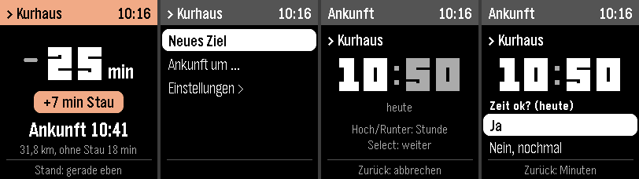
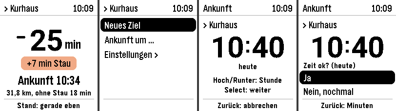

# Fahrzeit

Pebble-App, die live anzeigt, wie lange die Autofahrt gerade dauert, mit Verkehr. Sie fragt TomTom direkt vom Handy aus ab und braucht weder Home Assistant noch einen eigenen Server. Man braucht nur einen kostenlosen API-Key von TomTom.

Schwester-Projekt: [pebble-fahrzeit-HA](https://github.com/T-o-n-i/pebble-fahrzeit-HA) speist dieselbe Anzeige aus Home-Assistant-Sensoren.

Plattform: emery (Pebble Time 2).





*Oben die Ansicht „Toni“ (Standard), unten „Papier“: Fahrzeit, Menü, Ankunftszeit wählen und bestätigen.*

## Einrichten

1. Auf [developer.tomtom.com](https://developer.tomtom.com) ein kostenloses Konto anlegen und einen API-Key erzeugen. Zahlungsdaten sind nicht nötig. Das Freikontingent gilt pro Monat und für das ganze Konto, alle Keys teilen es sich. Für die Routing API sind es 20.000 Abfragen im Monat (Stand Oktober 2026, siehe [TomTom Pricing](https://docs.tomtom.com/pricing)). Ist es aufgebraucht, werden Abfragen bis zum nächsten Abrechnungszeitraum blockiert, Kosten entstehen nicht.
2. `fahrzeit.pbw` auf das Handy bringen und in der Pebble-App öffnen.
3. In der Pebble-App die Einstellungen von „Fahrzeit“ öffnen, Key und Favoriten eintragen, **Speichern**.

Wer schon die alte Version mit Ort 1 und Ort 2 hatte: Beim ersten Start werden beide Orte als Favoriten übernommen, Key und Zuschlag auch.

## Auf der Uhr

| Bildschirm | Was er zeigt | Tasten |
|---|---|---|
| **Wohin?** | Favoriten (Fahrt ab dem eigenen Standort) und Strecken (fester Start), die meistgenutzten oben | Select: losrechnen · Select lang: Ankunft um … oder Löschen |
| **Fahrzeit** | Kopfzeile in der Stau-Farbe, Fahrzeit mit Trendpfeil, Stau, Ankunft bei Abfahrt jetzt bzw. „Los 16:55“ | Select: sofort neu abfragen · Select lang: Menü |
| **Menü** | Neues Ziel · Ankunft um … (ändern, löschen) · Einstellungen | Zurück: eine Ebene hoch |
| **Ankunft** | Uhrzeit groß, erst die Stunde, dann die Minuten in 5er-Schritten, danach „Zeit ok?“ | Hoch/Runter stellen, Select weiter |

- Eine Wahl gilt eine Stunde. Danach fragt die App **Neues Ziel?**, mit Ankunftszeit erst 10 Minuten nach der Abfahrt
- Mit Ankunftszeit zeigt die Seite, wann man **losfahren** muss: grün, gelb kurz vorher, rot und „5 min zu spät“, wenn es vorbei ist
- **Erinnerung** vor der Abfahrt (5 bis 30 Minuten, an Uhr und Handy einstellbar): Die Uhr weckt sich selbst und vibriert
- Liegt die Ankunft mehr als 90 Minuten in der Zukunft, fragt die App TomTom nach der Prognose für diese Uhrzeit (`arriveAt`)
- Löschen geht an der Uhr über eine Bestätigungsseite: nur die obere Taste bestätigt, Zurück heißt nein
- Die App fragt beim Öffnen und dann alle 3 Minuten ab. Nach 30 Minuten pausiert sie, Select startet sie wieder

## Ansichten

| | Toni (Standard) | Papier |
|---|---|---|
| Uhr | Tonis Original: schwarz, Kopfzeile in der Stau-Farbe, LECO-Ziffern, Stau als Pille | schwarz auf weiß, alles fett, kein Grau in der Schrift, Ziffern in Roboto Bold. Am besten lesbar bei Tageslicht |
| Einstellungsseite | dunkles Grau mit Orange wie die bisherige Clay-Seite | weiß, schwarz, fett |

Umschalten an der Uhr unter Menü › Einstellungen › Ansicht oder in der Pebble-App unter *Anzeige auf der Uhr*.

## Einstellungsseite

Eigene Seite statt Clay, mit Übersicht und Unterseiten. Änderungen werden erst mit **Speichern** an die Uhr geschickt.

| Unterseite | Inhalt |
|---|---|
| Favoriten | bis 20 Ziele mit Name und Adresse (Suche über TomTom) und eigener Toleranz |
| Strecken | bis 10 Fahrten mit festem Start, etwa der Heimweg eines Kollegen. Mit Rückfahrt auf Knopfdruck |
| Puffer und Erinnerung | allgemeiner Zuschlag in %, Puffer in Minuten, Vorlauf der Erinnerung |
| Anzeige auf der Uhr | Toni oder Papier |
| TomTom-Key | Eingabe und Prüfen |

TomTom rechnet eher optimistisch. Angezeigt wird deshalb `Fahrzeit von TomTom × (1 + Zuschlag) + Puffer + Parken`, gerundet auf ganze Minuten. Zuschlag und Puffer gelten allgemein, jeder Favorit und jede Strecke kann eigene Werte haben (etwa mehr Toleranz zur Arbeit), Parken nur je Ziel. Stau-Minuten und Farbe bleiben bei den Werten von TomTom.

Orte gehen als Koordinaten oder als Adresse:

- **Koordinaten**: `50.04885, 8.55722`, `50.04885 8.55722` oder mit Dezimalkomma `50,04885; 8,55722`.
- **Adresse**: wird einmal über die TomTom-Suche aufgelöst und dann gemerkt.

Am genauesten sind Koordinaten auf der Zufahrt, etwa zum Parkhaus. Ein Routendienst legt jeden Punkt auf die nächste Straße. Liegt der Punkt mitten in einem großen Gebäude oder neben einer Autobahn, kann er auf der falschen Straße landen, und die Fahrzeit stimmt nicht.

Key, Orte und Korrektur liegen nur im `localStorage` von PebbleKit JS auf dem Handy. An die Uhr gehen nur Namen, fertige Minuten, Erinnerung und Ansicht.

## Fehlermeldungen

| Meldung | Bedeutung |
|---|---|
| API-Key fehlt: Einstellungen | kein Key eingetragen |
| Start fehlt / Ziel fehlt: Einstellungen | bei der Strecke oder dem Favoriten fehlt ein Ort |
| Kein Standort | das Handy liefert keinen Standort (nur bei Favoriten) |
| Key falsch oder Kontingent leer | TomTom lehnt die Abfrage ab (403); das passiert bei einem falschen Key und auch, wenn das Monatskontingent aufgebraucht ist |
| Zu viele Anfragen, kurz warten | zu viele Abfragen in kurzer Zeit (429) |
| Keine Route gefunden | TomTom findet keine Autoroute zwischen den Orten |
| … nicht gefunden | die Adresse liefert keinen Treffer |
| Ziel gibt es nicht mehr | das gewählte Ziel wurde inzwischen gelöscht |
| TomTom nicht erreichbar / TomTom antwortet nicht | Netzwerkfehler oder keine Antwort in 15 Sekunden |
| Handy nicht verbunden / Keine Antwort vom Handy | Uhr erreicht PebbleKit JS nicht |

## Aufbau

| Datei | Inhalt |
|---|---|
| `src/c/main.c` | Uhr: Wohin?, Seite, Listen, Bestätigung, Zeitwahl, Wecker. Zeichnen für beide Ansichten über `t_…`, Farben und Schriften aus `farben_setzen()` |
| `src/pkjs/index.js` | Handy: Daten, Standort, Adressen auflösen, Route bei TomTom abfragen, Einstellungsseite öffnen und speichern |
| `src/pkjs/logik.js` | gemeinsam für Handy und Einstellungsseite: Datenmodell, Korrektur, Liste für die Uhr, Übernahme der alten Einstellungen |
| `src/pkjs/einstellungen.html` | Einstellungsseite; `tools/seite_erzeugen.py` macht daraus `einstellungen_seite.js` |
| `resources/fonts/Ziffern-Roboto-Bold.ttf` | Roboto Bold (Apache 2.0), auf Ziffern gekürzt, für die Ansicht Papier |
| `tools/test/handy_test.js` | Node-Test mit nachgebauter Uhr und nachgebautem TomTom, ohne Netz |

## Bauen

```bash
python3 tools/seite_erzeugen.py
pebble build
pebble install --emulator emery
node tools/test/handy_test.js
```

`tools/bauen.sh` macht dasselbe außerhalb des Quellordners und prüft vorher, dass kein TomTom-Key in den Dateien steht. Nach neuen Message-Keys in `package.json` `build/` löschen, sonst fehlen die `MESSAGE_KEY_*`-Konstanten im C-Code.
